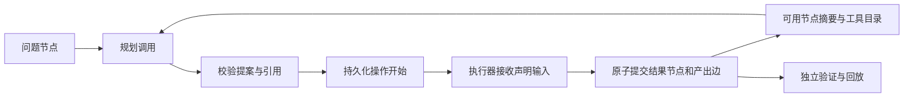

# 运行时架构

一次模型规划只选择操作、输入和目标。规划尝试单独保存。执行器收到完整的所选节点版本，运行时不附加原问题、图摘要或对话历史。需要原问题时应将问题节点列为输入。工具参数和操作目标随操作记录保存。模型的中间判断应由 `INFER` 或 `COMPARE` 生成独立节点。

一条消费边从节点指向操作，一条产出边从操作指向节点。运行时先提交开始事件，其中包含操作记录与输入边。输出校验成功后，一次提交完成状态、所有输出节点、产出边及运行状态。失败会保留操作及错误，输出集合为空。

内存和 SQLite 共用按 Run 分区的追加式事件接口。SQLite 用 `(run_id, sequence)` 主键索引和写事务，两个写入者争用同一序号时会发现冲突。版本修订占用同一运行的写入序列。历史图从指定事件前缀顺序重建。数据库保留运行开始与结束状态，可用于辨认异常中止时尚未完成的操作。

包的主要边界为 `protocol`、`runtime`、`graph`、`storage`、`adapters` 与 `verification`。

## 扩展接口

- PostgreSQL 可实现 `StorageBackend.append()` 和 `events()`，在事务内分配每 Run 的序号并实现期望序号校验。
- HTTP Server 可封装 Run 创建、接续、图查询与验证 API，服务层负责认证、访问隔离与请求调度。
- Agent 框架可封装 `ModelAdapter` 或 `ToolAdapter`，也可把 RRM 作为可调用组件，使用 Run ID 查询结果和验证记录。
